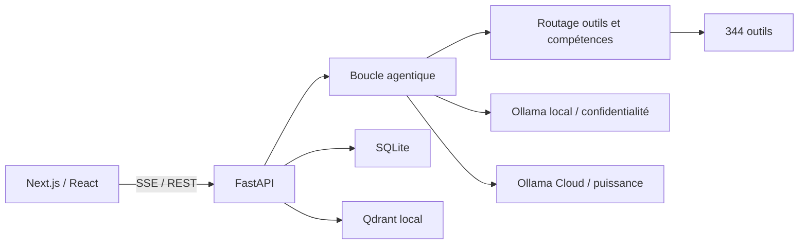

# Architecture de Marvin

Ce document décrit les frontières stables du projet. Il complète l’historique détaillé de
`backend/main.py` sans le dupliquer.

## Flux principal

## Responsabilités backend

| Module | Responsabilité |
|---|---|
| `main.py` | Composition FastAPI, endpoints historiques et déclaration des workers |
| `runtime_supervisor.py` | Propriété, déduplication, observation et arrêt idempotent des workers FastAPI |
| `runtime_workers.py` | Préchauffage et workers transverses de maintenance, sans dépendance à FastAPI |
| `communication_workers.py` | Boucles e-mail et agenda, réglages persistants et appels d'outils historiques |
| `proactive_service.py` | Briefings, anticipation, heures calmes et lecture vocale proactive |
| `cron_runtime.py` | Jobs planifiés, journal d'exécution et reprise bornée des tâches longues |
| `api/` | Routeurs par domaine : données, métiers, voix, agenda, IA, connexions, SSH, planification, monitoring et santé |
| `scheduling.py` | Parsing unique des planifications utilisé par l'API Cron et son worker |
| `agent.py` | Composition de la boucle agentique, prompt, outils, streaming et persistance |
| `agent_policy.py` | Politiques textuelles pures : titres et noms d'outils explicitement cités |
| `agent_prompt.py` | Prompt système, permissions, chemins dynamiques, mémoire et date déterministe |
| `agent_safety.py` | Validation pré-exécution des outils et analyse post-génération des scripts/documents |
| `agent_protocol.py` | Conversion UI/base vers Ollama et encodage JSON des événements SSE |
| `agent_routing.py` | Inventaire Ollama, sélection de profil et détection du contexte sensible |
| `agent_tool_selection.py` | Matrice d'outils, routage sémantique, repli borné et plafond déterministe |
| `agent_execution.py` | Frontière LLM/actions : registre injectable, reçus idempotents, erreurs et normalisation des appels textuels |
| `agent_review.py` | Revue indépendante injectable des réponses techniques et des actions sensibles |
| `agent_context.py` | Compaction du contexte de session et cycle de vie des captures multimodales |
| `agent_session.py` | Création/reprise du tour, persistance utilisateur, événements initiaux et titrage |
| `agent_planning.py` | Plan déterministe pré-LLM : intentions, Workspace, contraintes Cortex et budgets |
| `action_replay.py` | Reçus transactionnels et déduplication des actions à effet de bord d'un tour chat |
| `chat_turn_runtime.py` | Producteurs de tours détachés, journal SSE durable, curseurs de reconnexion et reprise sûre |
| `intent_guard.py` | Intentions déterministes avant LLM : aucun outil, commande texte, Council et Code Workspace |
| `tools.py` | Implémentations, registre et schémas des outils exposés au LLM |
| `tool_domains/` | Implémentations métier extraites; `tools.py` conserve la façade et les contrats publics pendant la migration |
| `config.py` | Profils de modèles, ports et politiques de permission |
| `database.py` | Façade historique d'accès SQLite et compatibilité défensive des domaines métier |
| `db_connection.py` | Fabrique de connexions WAL, clés étrangères et frontière commit/rollback |
| `db_migrations.py` | Catalogue de schéma versionné, checksums, compatibilité et rollback transactionnel |
| `repositories/` | Persistance métier injectable; conversations/messages extraits en premier |
| `skills.py` | Compétences Markdown, matching, apprentissage et versioning |
| `tool_router.py` | Index sémantique et sélection dynamique des outils |
| `cortex.py` | Contrats de mission, budgets adaptatifs, routage explicable, provenance et recettes Cortex |
| `cortex_search.py` | Exploration multi-stratégies, vérificateurs spécialisés et arbitrage Cloud |
| `forge.py` | Corpus de scénarios, notation déterministe, historique et métriques pass^k |
| `mission_os.py` | Missions durables, checkpoints, journal d'événements et preuves d'actions |
| `memory_mesh.py` | Métadonnées cognitives working, episodic, semantic et procedural |
| `truth_ledger.py` | Registre append-only des affirmations, sources et niveaux de preuve |
| `auto_config.py` | Adaptation des modèles et capacités au matériel |
| `cloud_routing.py` | Cloud facultatif, sélection par capacité et repli local |
| `model_market.py` | Catalogue dynamique, observations passives et classement des modèles cloud |
| `research_swarm.py` | Recherche web parallèle, contradiction, vérification et synthèse sourcée |
| `swarm_jobs.py` | Exécutions Research Swarm persistantes, annulables et reprenables |
| `evolution_lab.py` | Expériences bornées, comparaison baseline/candidate, promotion et rollback |
| `vector_store.py` | Embeddings et stockage Qdrant dans le processus backend |
| `doctor.py` | Diagnostics déterministes et réparations contrôlées |
| `app_version.py` | Source unique de la version publique |

## Responsabilités frontend

| Zone | Responsabilité |
|---|---|
| `app/` | Pages App Router et proxys Next.js compatibles avec l’UI historique |
| `lib/backend.js` | Résolution unique de l’URL FastAPI en local, LAN et SSR |
| `lib/chatStream.js` | Transport SSE reprenable, curseur `turnSeq` et reconnexion bornée sans doublon |
| `lib/contexts/ChatContext.jsx` | État global du chat et lecture du flux SSE |
| `components/chat/` | Saisie, rendu des messages, outils et fichiers |
| `components/sidebar/` | Navigation et état global visible |
| `lib/hooks/useVoice.js` | Capture, synthèse et mode vocal continu |

## Sources de vérité

- Version publique : `backend/app_version.py`.
- Données applicatives : backend Python et `data/secretary.db`.
- Outils disponibles : `TOOLS_REGISTRY` et `TOOLS_SPEC`, obligatoirement identiques.
- URL backend côté JavaScript : `lib/backend.js`.
- Historique fonctionnel fin : commentaires `# vX.Y` de `backend/main.py` et Git.
- État d'exécution des workers : `app.state.runtime_supervisor`.

Le résumé non sensible des workers est exposé dans `/api/health` (`total` et compte par
statut). Les messages d'exception complets restent internes au processus et aux journaux afin
de ne pas exposer accidentellement des données dans une réponse HTTP.

## Invariants automatisés

`scripts/check_architecture.py` fonctionne sans importer le backend et contrôle :

1. l’alignement des versions Python, npm et lockfile ;
2. l’égalité exacte entre registre et schémas des outils ;
3. l’absence de doublons d’outils et de routes ;
4. la validité des listes de permissions ;
5. la couverture des pages par le smoke test Playwright ;
6. l’absence de nouvelle URL FastAPI codée en dur dans le frontend ;
7. le montage de chaque module `api/*.py` et l’absence de route dupliquée après extraction ;
8. le contrat idempotent du superviseur des workers ;
9. l'idempotence, l'intégrité et le rollback des migrations SQLite sur une base temporaire ;
10. le démarrage de l'initialiseur Next.js sur une base vierge ;
11. les reçus d'action : déduplication, concurrence, interruption et masquage des secrets ;
12. les tours de chat détachables : journal durable, curseur, reconnexion et arrêt sûr.
13. la frontière d'exécution agentique : registre, reçus, erreurs et appels textuels bornés.
14. la revue indépendante : déclenchement, modèle distinct, constats substantiels et repli sûr.
15. le contexte agentique : cache de compaction, confinement et nettoyage des captures.
16. la préparation de session : création, idempotence du message, captures, titre et tâches suivies.
17. le plan de tour : suppression et obligation d'outils, reprise Workspace et budgets Cortex.

Toute lecture ou écriture SQLite applicative doit utiliser `with database.db()` ou un
repository. `scripts/test_db_connection_hygiene.py` refuse les appels directs à `get_conn()`
hors de `db_connection.py`, afin que fermeture, commit et rollback restent systématiques.

`scripts/check_marvin.py` orchestre ces invariants avec le contrôle du runtime, des
dépendances, de la compilation et du frontend. En mode `--live`, tous les contrôles backend
passent par HTTP : aucun second processus ne tente d’ouvrir le stockage Qdrant local.

## Règles d’évolution

- Ne jamais ouvrir Qdrant depuis un second processus Python.
- Ne pas déplacer la logique métier vers les routes Next.js : FastAPI reste la source de vérité.
- Une compétence reste du Markdown injecté au prompt, jamais du code exécutable.
- Toute action sortante ou irréversible conserve son mécanisme de confirmation.
- Les extractions futures de `main.py` et `tools.py` doivent se faire domaine par domaine,
  avec compatibilité d’import et contrôles verts avant chaque étape.
