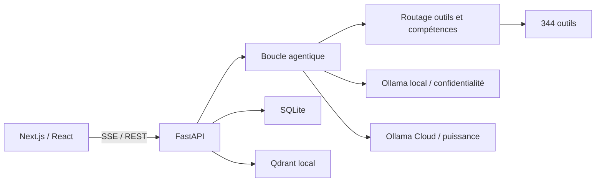

# Architecture de Marvin

Ce document décrit les frontières stables du projet. Il complète l’historique détaillé de
`backend/main.py` sans le dupliquer.

## Flux principal

## Responsabilités backend

| Module | Responsabilité |
|---|---|
| `main.py` | Composition FastAPI, endpoints historiques et déclaration des workers |
| `runtime_supervisor.py` | Propriété, déduplication, observation et arrêt idempotent des workers FastAPI |
| `runtime_workers.py` | Préchauffage et workers transverses de maintenance, sans dépendance à FastAPI |
| `communication_workers.py` | Boucles e-mail et agenda, réglages persistants et appels d'outils historiques |
| `proactive_service.py` | Briefings, anticipation, heures calmes et lecture vocale proactive |
| `cron_runtime.py` | Jobs planifiés, journal d'exécution et reprise bornée des tâches longues |
| `api/` | Routeurs par domaine : données, métiers, voix, agenda, IA, connexions, SSH, planification, monitoring et santé |
| `scheduling.py` | Parsing unique des planifications utilisé par l'API Cron et son worker |
| `agent.py` | Composition du Runner : session, contexte, itérations et délégation aux frontières spécialisées |
| `agent_policy.py` | Politiques textuelles pures : titres et noms d'outils explicitement cités |
| `agent_prompt.py` | Prompt système, permissions, chemins dynamiques, mémoire et date déterministe |
| `agent_safety.py` | Validation pré-exécution des outils et analyse post-génération des scripts/documents |
| `agent_protocol.py` | Conversion UI/base vers Ollama et encodage JSON des événements SSE |
| `agent_routing.py` | Inventaire Ollama, sélection de profil et détection du contexte sensible |
| `agent_tool_selection.py` | Matrice d'outils, routage sémantique, repli borné et plafond déterministe |
| `agent_execution.py` | Frontière LLM/actions : registre injectable, reçus idempotents, erreurs et normalisation des appels textuels |
| `agent_review.py` | Revue indépendante injectable des réponses techniques et des actions sensibles |
| `agent_context.py` | Compaction du contexte de session et cycle de vie des captures multimodales |
| `agent_session.py` | Création/reprise du tour, persistance utilisateur, événements initiaux et titrage |
| `agent_planning.py` | Plan déterministe pré-LLM : intentions, Workspace, contraintes Cortex et budgets |
| `agent_model_config.py` | Configuration typée du modèle, confidentialité, température, label et repli local |
| `agent_runner.py` | État observable du run : budget, outils, traces, blocages et résultat |
| `agent_observability.py` | Diffusion isolée des observations d'outils vers audit, SQLite, preuves et apprentissage |
| `agent_skill_outcome.py` | Issue idempotente des compétences, golden path et auto-amélioration suivie |
| `agent_council_escalation.py` | Arbitrage Council borné après désaccord explicite du vérificateur |
| `agent_learning.py` | Apprentissage post-réponse résident ou dédié et suivi anti-GC |
| `agent_turn_context.py` | Fenêtre d'historique, chemins, permissions et enrichissements persistants du prompt |
| `agent_enrichment.py` | Tâches concurrentes de rappel, matching et sélection d'outils avec annulation structurée |
| `agent_skill_context.py` | Méthode Markdown, golden path et ressources d'une compétence validée |
| `agent_model_step.py` | Lecture typée d'une itération Ollama et matérialisation des appels contractuels |
| `agent_tool_batch.py` | Exécution séquentielle, événements, preuves et persistance d'un lot d'outils |
| `agent_turn_completion.py` | Sortie commune : revue, persistance, apprentissage, skill et provenance |
| `agent_loop_policy.py` | Politiques inter-itérations : repli sensible, relance Skill et refus Forge |
| `agent_budget_completion.py` | Synthèse terminale sans outil et repli utilisateur lors d'un budget épuisé |
| `agent_transport.py` | Client HTTP Ollama, payload `/api/chat`, décodage JSONL et erreurs de transport typées |
| `document_formatting.py` | Projection Markdown commune aux générateurs DOCX/PDF et échappement ReportLab |
| `document_profile.py` | Identité persistante, champs autorisés et catalogue de modèles documentaires |
| `action_replay.py` | Reçus transactionnels et déduplication des actions à effet de bord d'un tour chat |
| `chat_turn_runtime.py` | Producteurs de tours détachés, journal SSE durable, curseurs de reconnexion et reprise sûre |
| `intent_guard.py` | Intentions déterministes avant LLM : aucun outil, commande texte, Council et Code Workspace |
| `tools.py` | Implémentations, registre et schémas des outils exposés au LLM |
| `tool_domains/` | Implémentations métier extraites (Fichiers, Documents/PDF, documentation d'intervention, sécurité et contrôles opérationnels, santé client, Winget, registre/paramètres/tweaks Windows, Web, Réseau, Facturation, contrôle/diagnostic PC, Windows, Quiz, Base IT, Tâches/Notes, Mémoire, Média, SSH); `tools.py` conserve la façade et les contrats publics pendant la migration |
| `config.py` | Profils de modèles, ports et politiques de permission |
| `database.py` | Façade historique d'accès SQLite et compatibilité défensive des domaines métier |
| `email_account_service.py` | Résolution partagée des comptes e-mail, façade multi-comptes et projection publique sans secrets |
| `ssh_transport.py` | Chargement des clés privées et connexions Paramiko partagés entre API et outils |
| `api/video_remote.py` | Catalogue Replicate, génération texte/image, suivi SSE, annulation et import des vidéos distantes |
| `api/video_editing.py` | Diaporamas, animations texte, stockage borné et montage ffmpeg local hors de la boucle asyncio |
| `api/video_local.py` | Capacités GPU, génération Diffusers texte/image, annulation et amélioration de prompt Ollama |
| `db_connection.py` | Fabrique de connexions WAL, clés étrangères et frontière commit/rollback |
| `db_migrations.py` | Catalogue de schéma versionné, checksums, compatibilité et rollback transactionnel |
| `repositories/` | Persistance métier injectable; conversations/messages, connexions SSH et workflows extraits |
| `skills.py` | Compétences Markdown, matching, apprentissage et versioning |
| `tool_router.py` | Index sémantique et sélection dynamique des outils |
| `cortex.py` | Contrats de mission, budgets adaptatifs, routage explicable, provenance et recettes Cortex |
| `cortex_search.py` | Exploration multi-stratégies, vérificateurs spécialisés et arbitrage Cloud |
| `forge.py` | Corpus de scénarios, notation déterministe, historique et métriques pass^k |
| `mission_os.py` | Missions durables, checkpoints, journal d'événements et preuves d'actions |
| `memory_mesh.py` | Métadonnées cognitives working, episodic, semantic et procedural |
| `truth_ledger.py` | Registre append-only des affirmations, sources et niveaux de preuve |
| `auto_config.py` | Adaptation des modèles et capacités au matériel |
| `cloud_routing.py` | Cloud facultatif, sélection par capacité et repli local |
| `model_market.py` | Catalogue dynamique, observations passives et classement des modèles cloud |
| `research_swarm.py` | Recherche web parallèle, contradiction, vérification et synthèse sourcée |
| `swarm_jobs.py` | Exécutions Research Swarm persistantes, annulables et reprenables |
| `evolution_lab.py` | Expériences bornées, comparaison baseline/candidate, promotion et rollback |
| `vector_store.py` | Embeddings et stockage Qdrant dans le processus backend |
| `doctor.py` | Diagnostics déterministes et réparations contrôlées |
| `app_version.py` | Source unique de la version publique |

## Responsabilités frontend

| Zone | Responsabilité |
|---|---|
| `app/` | Pages App Router et proxys Next.js compatibles avec l’UI historique |
| `lib/backend.js` | Résolution unique de l’URL FastAPI en local, LAN et SSR |
| `lib/chatStream.js` | Transport SSE reprenable, curseur `turnSeq` et reconnexion bornée sans doublon |
| `lib/contexts/ChatContext.jsx` | État global du chat et lecture du flux SSE |
| `components/chat/` | Saisie, rendu des messages, outils et fichiers |
| `components/sidebar/` | Navigation et état global visible |
| `lib/hooks/useVoice.js` | Capture, synthèse et mode vocal continu |

## Sources de vérité

- Version publique : `backend/app_version.py`.
- Données applicatives : backend Python et `data/secretary.db`.
- Outils disponibles : `TOOLS_REGISTRY` et `TOOLS_SPEC`, obligatoirement identiques.
- URL backend côté JavaScript : `lib/backend.js`.
- Historique fonctionnel fin : commentaires `# vX.Y` de `backend/main.py` et Git.
- État d'exécution des workers : `app.state.runtime_supervisor`.

Le résumé non sensible des workers est exposé dans `/api/health` (`total` et compte par
statut). Les messages d'exception complets restent internes au processus et aux journaux afin
de ne pas exposer accidentellement des données dans une réponse HTTP.

## Invariants automatisés

`scripts/check_architecture.py` fonctionne sans importer le backend et contrôle :

1. l’alignement des versions Python, npm et lockfile ;
2. l’égalité exacte entre registre et schémas des outils ;
3. l’absence de doublons d’outils et de routes ;
4. la validité des listes de permissions ;
5. la couverture des pages par le smoke test Playwright ;
6. l’absence de nouvelle URL FastAPI codée en dur dans le frontend ;
7. le montage de chaque module `api/*.py` et l’absence de route dupliquée après extraction ;
8. le contrat idempotent du superviseur des workers ;
9. l'idempotence, l'intégrité et le rollback des migrations SQLite sur une base temporaire ;
10. le démarrage de l'initialiseur Next.js sur une base vierge ;
11. les reçus d'action : déduplication, concurrence, interruption et masquage des secrets ;
12. les tours de chat détachables : journal durable, curseur, reconnexion et arrêt sûr.
13. la frontière d'exécution agentique : registre, reçus, erreurs et appels textuels bornés.
14. la revue indépendante : déclenchement, modèle distinct, constats substantiels et repli sûr.
15. le contexte agentique : cache de compaction, confinement et nettoyage des captures.
16. la préparation de session : création, idempotence du message, captures, titre et tâches suivies.
17. le plan de tour : suppression et obligation d'outils, reprise Workspace et budgets Cortex.
18. la configuration modèle : routage auto/manuel, contrats local/cloud et repli sensible.
19. l'état du Runner : progression, arrêt, preuves d'outils, blocages Forge et provenance.
20. l'observabilité du Runner : une panne de métrique, preuve ou apprentissage ne peut pas invalider une action exécutée.
21. le transport Ollama : payload, timeouts, JSONL et erreurs restent indépendants du Runner et du SSE frontend.
22. les domaines d'outils : chaque extraction préserve l'identité des fonctions du registre et l'égalité stricte des 344 implémentations/spécifications.
23. le routeur SSH : toutes les routes HTTP, SSE, WebSocket et SFTP appartiennent exclusivement à `api/ssh.py`; aucune copie de fonction ne subsiste dans `main.py`.
24. les comptes e-mail : configuration, liste, ajout, retrait et test appartiennent à `api/email_accounts.py`; la résolution OAuth/mot de passe passe par un service partagé.
25. la boîte e-mail : lecture/recherche/dossiers, envoi audité, mutations et pièces jointes appartiennent à `api/email_mailbox.py` et utilisent la même résolution multi-comptes.
26. les préférences e-mail : signatures, modèles, surveillance, alertes et règles appartiennent à `api/email_preferences.py`; leurs exécutions restent déléguées au registre d'outils.
27. l'IA e-mail : brouillons, résumés, digest, profils, scheduler, drafts et outbox appartiennent à `api/email_automation.py`; l'activation initiale exige une confirmation explicite.
28. la vidéo distante : modèles, générations texte/image, suivi SSE, annulation et import Replicate appartiennent à `api/video_remote.py`; le jeton reste lu par le gestionnaire de secrets.
29. le montage vidéo local : diaporamas, texte animé, fichiers et opérations ffmpeg appartiennent à `api/video_editing.py`; tout nom de fichier reste confiné au stockage vidéo.
30. la génération vidéo IA locale : capacités, modèles, SSE texte/image, annulation et amélioration du prompt appartiennent à `api/video_local.py`; les fichiers uploadés sont nettoyés sur toute sortie du stream.
31. les outils média : les 11 actions vidéo/GIF et 6 actions audio appartiennent à `tool_domains/media.py`; la façade injecte son résolveur de chemins et préserve les 17 identités du registre.
32. le transport SSH : l'API et les outils utilisent `ssh_transport.py`; aucune route ne dépend d'un helper SSH privé de `tools.py`.
33. le domaine SSH : cibles, commandes, scripts et transferts appartiennent à `tool_domains/ssh.py`; `api/ssh.py` ne dépend plus de `tools.py` et les neuf identités du registre sont préservées.
34. la persistance SSH : CRUD, statut de test et dernier usage appartiennent à `repositories/ssh_connections.py`; les listes publiques excluent les secrets et toute opération passe par la transaction `db()`.
35. la persistance des workflows : définitions et exécutions appartiennent à `repositories/workflows.py`; les anciens JSON invalides se replient sur une liste vide, l'historique est borné et la suppression d'un workflow avec ses exécutions est atomique.
36. la finalisation agentique : scan déterministe, critique indépendante et escalade Council appartiennent à `agent_finalization.py`; les sorties normales et par budget partagent le même ordre d'événements SSE.
37. les outils obligatoires : `agent_required_tools.py` matérialise les contrats explicites sans doublon, préserve l'autonomie tant que le modèle agit et injecte le contexte du livrable précédent uniquement pour une reprise Code Workspace.
38. l'étape d'outil : `agent_tool_step.py` normalise les variantes d'arguments des modèles, injecte les identifiants internes hors du LLM et borne uniquement la projection de résultat renvoyée au contexte modèle.
39. le dispatch d'outil : `agent_tool_dispatch.py` applique anti-polling, outil explicite, texte sans exécution, validation des arguments, niveau Sécurisé et confirmation Expert avant l'exécuteur idempotent.
40. la post-validation d'outil : `agent_tool_postprocess.py` normalise le contrat de résultat, critique les confirmations dangereuses et inspecte le contenu documentaire sans invalider une action déjà exécutée si un observateur tombe en panne.
41. l'issue d'une compétence : `agent_skill_outcome.py` enregistre une seule issue par tour, conserve le golden path des succès et suit l'auto-amélioration asynchrone d'un véritable échec d'outil.
42. les effets post-réponse : `agent_council_escalation.py` n'autorise Council qu'après un désaccord et une politique explicite; `agent_learning.py` choisit la stratégie résidente ou dédiée et conserve toute tâche jusqu'à sa fin.
43. le contexte de tour : `agent_turn_context.py` prépare l'historique, les chemins réels, les permissions, les mémoires, les contraintes Cortex, le projet et l'identité documentaire avec des replis déterministes.
44. les enrichissements du tour : `agent_enrichment.py` isole rappel, matching et catalogue, absorbe leurs pannes indépendantes et annule toute tâche restante lors d'une sortie anticipée; `agent_skill_context.py` refuse une compétence incomplète sans casser le chat.
45. l'itération modèle : `agent_model_step.py` projette thinking et texte, collecte les appels natifs, récupère les appels textuels et matérialise les outils requis avant toute exécution.
46. le lot d'outils : `agent_tool_batch.py` conserve l'ordre dispatch, post-validation, `tool_end`, état Runner, observabilité, contexte Ollama et persistance; une panne d'observation ne transforme jamais l'action exécutée en échec.
47. la sortie du tour : `agent_turn_completion.py` impose le même ordre de revue, persistance, issue de compétence, recette Cortex, provenance et `done` aux terminaisons normales et par budget; l'apprentissage reste désactivé pour une synthèse incomplète par budget.
48. les archives : `tool_domains/archives.py` crée les ZIP de façon atomique et extrait ZIP/TAR membre par membre; chemins absolus ou traversants, liens, fichiers spéciaux et décompressions hors limites sont refusés avant écriture.
49. les tableurs : `tool_domains/spreadsheets.py` possède création et lecture XLSX ainsi que les conversions CSV; les sorties sont atomiques, les CSV traités en flux borné et les classeurs fermés sur toute sortie.
50. l'OCR vision : `tool_domains/ocr.py` conserve le routage Cloud/local de confidentialité, borne et valide l'image avant encodage et isole le transport Ollama derrière une interface injectable.
51. les captures documentaires : `tool_domains/screenshots.py` analyse les images selon le profil de confidentialité, projette l'index SQLite et compose DOCX/PDF; `agent_context.py` dépend directement de ce domaine et non de la façade globale `tools.py`.
52. les images locales : `tool_domains/images.py` possède inspection, resize, crop, rotation, compression, PDF et lots; orientation EXIF, limites de pixels/fichiers, paramètres et sorties atomiques sont uniformes.
53. le noyau PDF : `tool_domains/pdf_core.py` possède lecture, métadonnées, fusion, découpage et rotation; sélections de pages, volumes, chiffrement et écritures atomiques sont gérés sans dépendance aux moteurs OCR/rendu.
54. le PDF avancé : `tool_domains/pdf_advanced.py` possède filigrane, protection AES, extraction/rendu d'images, OCR, AcroForm, compression et numérotation; les transports et réglages OCR sont injectés, les dépendances optionnelles restent confinées.
55. la connaissance documentaire : `tool_domains/document_knowledge.py` possède extraction multi-format, indexation Qdrant, Q/R RAG, inventaire, oubli et affinage de section; le magasin vectoriel reste injecté depuis le processus backend et les documents générés sont confinés par relation de chemin.
56. la documentation d'intervention : `tool_domains/intervention_docs.py` possède le CRUD d'interventions, l'analyse de notes, les livrables ITIL, les actifs et la recherche historique; les générateurs DOCX/PDF et l'analyse de commandes sont injectés, les formats et volumes sont validés.
57. la sécurité des commandes : `tool_domains/command_safety.py` extrait les commandes, détecte leur plateforme, applique les règles de risque et trace les approbations sans jamais exécuter la commande; entrées et volumes sont bornés.
58. les contrôles opérationnels : `tool_domains/operations_safety.py` possède les modèles et exécutions déclaratives de pré/post-checks, les preuves et leur rapport; le type de checklist, les statuts, les lots et les formats sont contrôlés avant persistance.
59. la santé client : `tool_domains/client_health.py` agrège documentation, actifs, incidents, commandes et sauvegardes en scores et recommandations, puis produit historique et synthèse mensuelle; limites, statuts et formats sont explicites.
60. Winget : `tool_domains/winget.py` possède découverte, parsing, recherche, inventaire et mutations non interactives; limites, sources et identifiants sont validés, et toute mutation reste confirmée.
61. les paramètres Windows : `tool_domains/windows_settings.py` possède alimentation, thème, pare-feu, cartes réseau et hibernation; le transport PowerShell est injecté et les valeurs composées dans un script sont validées avant exécution confirmée.
62. le registre Windows : `tool_domains/windows_registry.py` possède point de restauration, lecture, export et écriture; chemins, noms, types et valeurs sont validés/encodés avant PowerShell, avec sauvegarde et confirmation sur mutation.
63. les tweaks Windows : `tool_domains/windows_tweaks.py` possède télémétrie, débloat et réglages réseau; les dépendances registre sont injectées et le retrait UWP est limité au catalogue exact présenté par Marvin.

Toute lecture ou écriture SQLite applicative doit utiliser `with database.db()` ou un
repository. `scripts/test_db_connection_hygiene.py` refuse les appels directs à `get_conn()`
hors de `db_connection.py`, afin que fermeture, commit et rollback restent systématiques.

`scripts/check_marvin.py` orchestre ces invariants avec le contrôle du runtime, des
dépendances, de la compilation et du frontend. En mode `--live`, tous les contrôles backend
passent par HTTP : aucun second processus ne tente d’ouvrir le stockage Qdrant local.

## Règles d’évolution

- Ne jamais ouvrir Qdrant depuis un second processus Python.
- Ne pas déplacer la logique métier vers les routes Next.js : FastAPI reste la source de vérité.
- Une compétence reste du Markdown injecté au prompt, jamais du code exécutable.
- Toute action sortante ou irréversible conserve son mécanisme de confirmation.
- Les extractions futures de `main.py` et `tools.py` doivent se faire domaine par domaine,
  avec compatibilité d’import et contrôles verts avant chaque étape.
